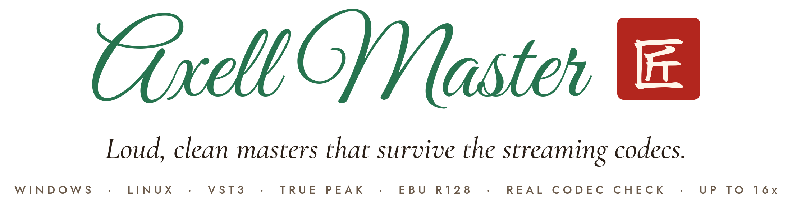
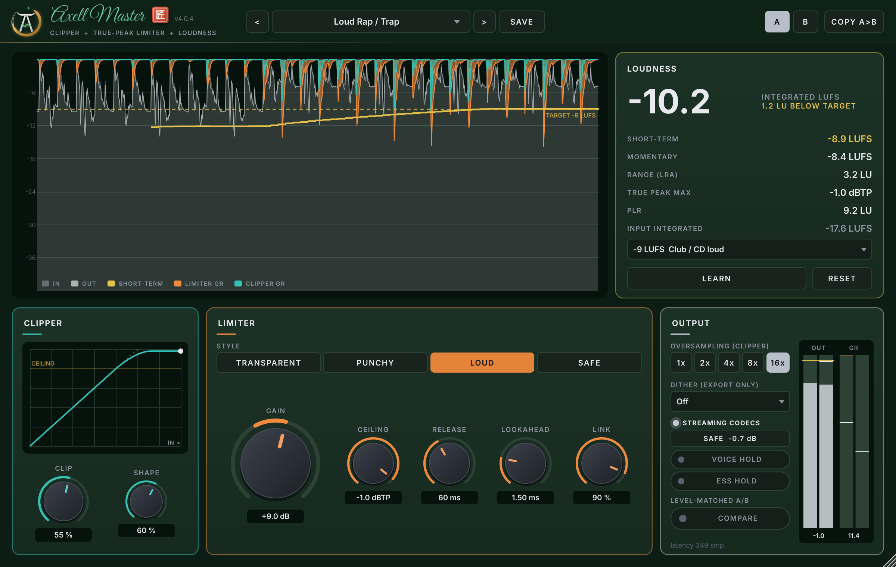
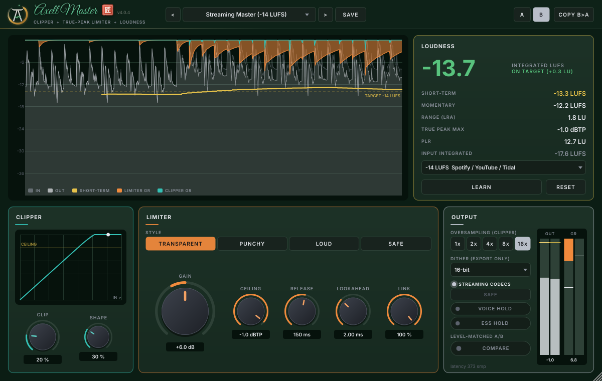
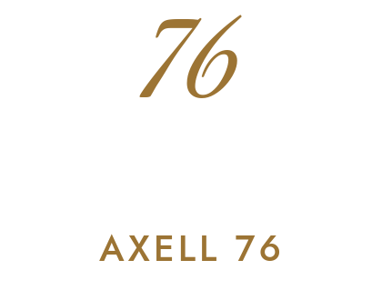

<picture>
  <source media="(prefers-color-scheme: dark)" srcset="docs/img/type/hero-dark.png">
  
</picture>

  
  
  
  
  
  

  

  <b>Loud masters that stay clean - even after Spotify and YouTube encode them.</b> 
  A 16x oversampled clipper into a true-peak limiter, a broadcast-standard loudness meter, and a live check of your master through the real streaming codecs, with SAFE to keep it from clipping after the encode.

  <a href="https://github.com/zmardanian/axell-master/releases/latest"><picture>
  <source media="(prefers-color-scheme: dark)" srcset="docs/img/type/dl-windows-dark.png">
  
</picture></a>
  &nbsp;&nbsp;
  <a href="https://github.com/zmardanian/axell-master/releases/latest"><picture>
  <source media="(prefers-color-scheme: dark)" srcset="docs/img/type/dl-linux-dark.png">
  
</picture></a>

Free and open source (AGPL-3.0)  ·  Windows 10 / 11 and Linux  ·  any VST3 host - FL Studio, Ableton Live, Cubase, Studio One, Bitwig, REAPER

 

<picture>
  <source media="(prefers-color-scheme: dark)" srcset="docs/img/type/h-why-dark.png">
  
</picture>

- **Streaming-safe, proven** - after SAFE: 0 clipped samples through Opus, Vorbis, AAC and MP3 on 9 loud rap masters.
- **A ceiling it actually holds** - worst -1.017 dBTP at a -1 dBTP ceiling on mixes driven +12 to +14 dB, measured by an independent reconstruction.
- **Clean bass under heavy limiting** - 40-50 Hz at 6 dB of limiting: -139 dB THD+N (Transparent).
- **Made for vocals too** - VOICE HOLD and ESS HOLD keep pauses and esses where they belong on a vocal bus.
- **16 % lighter in 4.0.3** - 22 % on Windows - byte-for-byte the same sound.

 

<picture>
  <source media="(prefers-color-scheme: dark)" srcset="docs/img/type/h-does-dark.png">
  
</picture>

The mastering limiter of the Axell suite: an oversampled soft clipper into a true-peak limiter, with a loudness
meter to the broadcast standard, delivery targets with LEARN, a level-matched COMPARE, psychoacoustically shaped
dither for the export, and (2.0) a check of the master through the real streaming codecs, with SAFE to keep a loud
master from clipping after YouTube or Spotify encode it. Built for rap, trap and boom-bap masters, and transparent enough for acoustic music.

**GAIN** drives the mix into the processing. **LEARN** sets it for you: play the song, press LEARN, then APPLY.
GAIN moves to hit the chosen target. A second pass lands within a few tenths of an LU.

**CLIPPER** shaves the shortest peaks (kicks, snares) before the limiter, so the limiter works less and pumps less.
- CLIP sets how much of the peak reduction is clipping.
- SHAPE runs from soft (rounded) to hard (flat).
- 16x oversampling is the default (1x / 2x / 4x / 8x selectable). Even a hard clip of a bright mix stays clean:
  aliasing is below -99 dBc.
- The live curve shows the clipper's transfer and your loudest recent peak.

**LIMITER** is a true-peak limiter (ceiling -24 to 0 dBTP, release 1-1000 ms, look-ahead 0.5-5 ms, stereo link).
It has four program-dependent release styles:
- **TRANSPARENT** (default): natural.
- **PUNCHY**: drums keep their snap.
- **LOUD**: the densest.
- **SAFE**: the slowest.

A lone peak recovers fast and dense passages slowly. A bass-aware hold keeps the gain steady through a bass note's
cycle: 40-50 Hz bass at 6 dB of limiting measures -139 dB THD+N in Transparent and Safe.

**LOUDNESS** follows ITU-R BS.1770-4 / EBU R128. It shows:
- integrated (large), short-term, momentary;
- loudness range (EBU Tech 3342);
- true peak (8x, twice the standard's minimum);
- PLR;
- the input's integrated loudness.

Targets: -14 LUFS (Spotify / YouTube / Tidal), -16 (Apple Music), -9 (club / CD), -23 (EBU R128), -24 (ATSC A/85).
The history shows the last seconds: peaks in and out, short-term loudness against the target, and clipper and
limiter gain reduction.

**OUTPUT**:
- **VOICE HOLD** (3.0, for a vocal or vocal bus): in the voice's pauses the limiter holds its gain instead of
  releasing, so the drive does not lift the room and the breaths (Vocal Peak Catcher +12 dB on a real take: pauses
  +8.1 -> +2.7 dB re the voice). On in the vocal presets; leave it off on a mix or a beat.
- **ESS HOLD** (4.0, for a vocal or vocal bus): through each ess the limiter holds the word's gain instead of
  releasing, so the drive does not push the esses above the vowels (Vocal Peak Catcher +12 dB, 28 real takes: esses
  over their word +2.76 -> +0.40 dB, vowels within 0.02 dB). On in the vocal presets; leave it off on a mix or a beat.
- **COMPARE** plays the unprocessed mix at the master's loudness, so you hear what the processing does and not just
  "louder". In the audit it matched within 0.03 LU.
- **DITHER** for the final export: 24-bit or 16-bit TPDF, or 16-bit shaped. The shaped mode uses the 9th-order
  F-weighted minimally audible filter (Wannamaker, JAES 1992), which is 22 dB quieter than plain TPDF at 2-5 kHz.

**STREAMING CODECS** (2.0). A -1 dBTP ceiling protects the file, but the services re-encode it, and a lossy codec's
decoded peaks land higher than the master's. Measured on real rap masters at -9 LUFS, 1.0's -1 dBTP masters decoded
at up to +1.1 dBTP (Vorbis 160, Spotify) and +0.6 (AAC), with clipped samples in every song.
- **The check:** while the master plays, it is encoded and decoded with the real Opus 160 kbps (YouTube) and
  Vorbis 160 kbps (Spotify) libraries, each at four frame offsets. Where the frames fall moves the decoded peak by up
  to 0.9 dB, and the service's framing is unknown.
- **Display:** the decoded true peak and clipped samples since the last change. Green = safe, amber = within
  0.3 dB of full scale, red = clips.
- **Threading:** it runs on its own thread and never touches the audio. On / off with the STREAMING CODECS switch.
- **SAFE:** lowers the ceiling until both codecs decode at -0.3 dBTP or below. Play the song again and press again
  if offered: a lower ceiling means denser limiting, so it usually takes 1-3 presses.
  - Verified on 9 loud masters: 0 clipped samples with Opus, Vorbis 160 / 320, FDK AAC 256 and MP3 320 at 6 frame
    offsets each.
  - It costs 0.5-1.3 LU on a -9 LUFS master. That is the price of a loud master that survives streaming, and you
  choose when to pay it.

There are 28 factory presets (2.0 added 20), grouped in the menu:
- **MASTER:** streaming, Apple Music, hip-hop / R&B, pop, EDM, rock, lo-fi, club, acoustic, podcast, broadcast,
  mix-bus safety.
- **YOUR STUDIO (BOOM BAP):** boom bap streaming master, a loud master that survives the codecs without SAFE, booth
  rap vocal bus, drum bus knock, beat tape master.
- **VOCAL BUS:** peak catcher, upfront, ad-libs / doubles, sung vocal.
- **BEAT / DRUM BUS:** drum bus punch, 808 / sub control, trap hard clip, sample-based glue.

Each 2.0 preset was checked on real material (DECISIONS M17), and its description shows as the tooltip of the preset
name. User presets and A/B too. Presets never change GAIN: how hard to drive depends on the mix, not the genre.

<table>
<tr><td align="center" width="50%"> STREAMING CODECS - the live check</td></tr>
</table>

 

<picture>
  <source media="(prefers-color-scheme: dark)" srcset="docs/img/type/h-new-dark.png">
  
</picture>

### What's new in 4.0

- **ESS HOLD (for a vocal or vocal bus)**: driving a vocal into a limiter lifts its esses - between a vowel and its ess
  the limiter starts to release, and the S, SH and CH sounds come up against their own word. With ESS HOLD the
  suite's sibilance detector (Axell Velvet's, zero latency) marks the esses and the limiter holds the word's gain
  through each one, then glides back (10 ms) to exactly what 3.0 does - Axell Duo Compressor 4.0's method, built into
  the shared core limiter (attack and ceiling untouched). On 28 of the artist's raw takes, Vocal Peak Catcher driven
  +12 dB: esses over their word **+2.76 -> +0.40 dB** (Booth Rap Vocal Bus +2.29 -> +0.48, Vocal Upfront +2.88 -> +0.87,
  Ad-libs +3.73 -> +1.46); vowels within 0.1 dB, pauses and peaks unchanged. On in the vocal presets, off by default;
  projects from before 4.0 sound exactly as before.

### What was new in 3.0

- **VOICE HOLD (for a vocal or vocal bus)**: driving a vocal into the limiter lifts the room, breaths and headphone
  bleed between phrases by as much as the words are limited. With VOICE HOLD the suite's voice detector (Axell Gate's)
  marks the pauses and the limiter holds its gain at the voice's level there instead of releasing - Axell Duo
  Compressor 3.0's method, built into the shared core limiter (attack and ceiling untouched). On a real take,
  Vocal Peak Catcher driven +12 dB: pauses **+8.1 -> +2.7 dB** re the voice, the voice limited exactly as before. On in
  the vocal presets, off by default (on a mix or a beat the detector would take drum hits for a voice).
- **Axell's Dojo look**: the family emblem, a brush-written title with Master's seal (匠, "master craftsman"), a
  forest-green ground.

 

<picture>
  <source media="(prefers-color-scheme: dark)" srcset="docs/img/type/h-measured-dark.png">
  
</picture>

| | |
|---|---|
| Streaming codecs after SAFE (9 loud rap masters, 6 frame offsets per codec) | 0 clipped samples with Opus 160, Vorbis 160 / 320, FDK AAC 256, MP3 320; worst decoded -0.08 dBTP |
| In-plugin codec check vs ffmpeg's encoders | Opus within 0.16 dB, Vorbis within 0.1 dB (same framing) |
| Codec check on vs off | bit-identical audio (it only listens, on its own thread) |
| Silence in | exactly 0 out |
| Below the ceiling | output = input delayed by the reported latency: error -138 dBFS at 1x, -125 dBFS at 16x |
| True-peak ceiling, -1 dBTP, mixes driven +12 to +14 dB | worst -1.017 dBTP (independent reconstruction), every style, link, clip and oversampling setting, 44.1 / 48 / 96 kHz, full-band input |
| Clipper aliasing, 5 kHz hard-clipped 6 dB | 16x -106 dBc, 8x -94 dBc, 4x -76 dBc (worst of 44.1 / 48 / 96 kHz) |
| Bass distortion, 40-50 Hz at ~6 dB of limiting | Transparent / Safe -139 dB, Punchy -83 dB, Loud -57 dB THD+N |
| Loudness meter | EBU Tech 3341 cases 1-5 and Tech 3342 cases 1-4 at 44.1 / 48 / 96 kHz |
| Live latency changes | the host is told first; output always aligned (0 misaligned windows through a real-time host) |
| Host block sizes 1-4096, everything on | identical output |
| CPU (48 kHz stereo, one core) | 3.9 % at defaults (16x, 4.0.3), 3.4 % at 4x; the codec check adds ~15 % of one core on its own thread (switchable) |
| Real-time safety | no allocation, lock or I/O in the audio path (allocation counter in the test suite) |
| VOICE HOLD, a real take (vocal presets driven +18 dB) | pauses re the voice: Peak Catcher +13.9 -> +4.6 dB, Sung Vocal +6.8 -> +0.7, Booth Rap +6.1 -> +2.5; the voice's limiting within 0.2 dB |
| VOICE HOLD, synthetic voice (all rates) | pause lift 6.7 -> 0.1 dB, voice level unchanged, the ceiling held |
| ESS HOLD, 28 real takes (vocal presets driven +12 dB) | esses over their word: Peak Catcher +2.76 -> +0.40 dB, Booth Rap +2.29 -> +0.48, Upfront +2.88 -> +0.87, Ad-libs +3.73 -> +1.46; vowels within 0.1 dB, pauses and true peak unchanged |

All of these come from:
- the automated suites: `tests/`, 378 DSP checks at 44.1 / 48 / 96 kHz (the codec check also at 88.2 kHz) plus 61
  plugin checks; the core adds 143 checks (the limiter's VOICE HOLD and ESS HOLD included);
- an independent black-box audit through a VST3 host (`tests/independent/master_audit.py`, 25 checks, analysis from
  textbook definitions);
- the studies in `research/`: real masters through the streaming codecs, SAFE's calibration, every preset on real
  material;
- AddressSanitizer + UBSan;
- pluginval at strictness 10;
- Steinberg's VST3 validator (47/47).

The reports are in `tests/`; the reasoning behind every design choice is in [docs/DECISIONS.md](docs/DECISIONS.md).

 

<picture>
  <source media="(prefers-color-scheme: dark)" srcset="docs/img/type/h-install-dark.png">
  
</picture>

### Windows

> [!TIP]
> **The whole suite in one go:** the [Axell Signature Suite installer](https://github.com/zmardanian/axell-signature-dojo/releases/latest) puts every Axell plugin and the Dojo on Windows 10 / 11 in one step, each one optional - and the Dojo keeps them up to date. Every VST3 host loads them: FL Studio, Ableton Live, Cubase, Studio One, Bitwig, REAPER.

Windows 10 / 11, 64-bit. Download `AxellMaster-<version>-windows-x64.tar.gz` from the
[latest release](https://github.com/zmardanian/axell-master/releases/latest) (optional: check it against `SHA256SUMS.txt`),
extract it (Windows 11 opens .tar.gz directly; on Windows 10 use 7-Zip or `tar -xzf` in a terminal) and copy the folder
`Axell Master.vst3` into `C:\Program Files\Common Files\VST3`. Then rescan plugins in your DAW.
Or install the whole suite in one go with the Axell Signature Suite installer from the
[Axell Signature Dojo releases](https://github.com/zmardanian/axell-signature-dojo/releases/latest) - the Dojo then keeps it up to date.

Your own presets are kept in `%APPDATA%\AxellMaster\Presets`.

Every Windows build is made by GitHub Actions from this repository, passes the same test suites and pluginval
(strictness 10) as the Linux build, and is checked to sound the same as it (largest difference far below -90 dBFS,
most often bit-identical). The plugin is not code-signed yet; DAWs load it directly.

### Linux

Download `AxellMaster-4.0.3-linux-x86_64.tar.gz` from the
[latest release](https://github.com/zmardanian/axell-master/releases/latest) (optional: `sha256sum -c SHA256SUMS.txt`), then:

    tar xzf AxellMaster-4.0.3-linux-x86_64.tar.gz
    cd AxellMaster-4.0.3-linux-x86_64
    ./install.sh

The installer copies `Axell Master.vst3` to `~/.vst3`. Then in REAPER: Options > Preferences > Plug-ins > VST >
Re-scan. Put it last on the master bus. Or let the [Axell Signature Dojo](https://github.com/zmardanian/axell-signature-dojo)
install and update it.

 

<picture>
  <source media="(prefers-color-scheme: dark)" srcset="docs/img/type/h-history-dark.png">
  
</picture>

| Version | Date | Engineering | Measured |
|---|---|---|---|
| **1.0.0** | 2026-10-15 | Oversampled soft clipper (16x default) into a true-peak limiter with four program-dependent release styles and a bass-aware hold; BS.1770-4 / EBU R128 meter; targets with LEARN; level-matched COMPARE; 9th-order F-weighted dither | Ceiling within 0.02 dB of -1 dBTP on mixes driven +12-14 dB (independent reconstruction); clipper aliasing -106 dBc at 16x; 40-50 Hz bass at 6 dB of limiting -139 dB THD+N; EBU Tech 3341/3342 conformance |
| **2.0.0** | 2026-10-17 | STREAMING CODECS: the master through real Opus and Vorbis encoders while it plays (4 frame offsets, own thread); SAFE lowers the ceiling until both decode at -0.3 dBTP; 20 presets checked on real material | 1.0's -1 dBTP masters decoded at up to +1.1 dBTP (Vorbis); after SAFE: 0 clipped samples on 9 loud masters with Opus, Vorbis 160/320, FDK AAC 256, MP3 320 |
| **3.0.0** | 2026-10-26 | VOICE HOLD for a vocal bus (Gate's voice detector + Duo 3.0's method in the shared core limiter); ESS GUARD studied and rejected (no net gain on the artist's mix, DECISIONS M18); Axell's Dojo look | Real take: pauses +8.1 -> +2.7 dB (+12 dB drive), voice unchanged; 378 DSP + 61 plugin checks, ASan clean, audit 25/25, pluginval L10, validator 47/47 |
| **4.0.0** | 2026-10-26 | ESS HOLD for a vocal bus (Velvet's sibilance detector + Duo 4.0's method in the shared core limiter: the word's gain through each ess, a shadow of the 3.0 path to return to) | 28 takes, +12 dB: esses over their word +2.76 -> +0.40 dB (Peak Catcher; +2.29..+3.73 -> +0.40..+1.46 over four vocal presets), vowels within 0.1 dB; 391 DSP + 66 plugin + 143 core checks, ASan clean, audit 29/29 (3.0 sessions bit-identical), pluginval L10, validator 47/47 |
| **4.0.1** | 2026-10-26 | Faster pitch analysis in the shared core (the suite's sibilance detector (ESS HOLD)): eight lags in registers, same summation order | Output byte-identical to 4.0.0; CPU vocal presets with VOICE HOLD + ESS HOLD 8.50 -> 7.59 % of one core (-10.8 %), other presets unchanged |
| **4.0.2** | 2026-10-27 | The version on the interface (small and quiet after the title) | Audio byte-identical to 4.0.1 |
| **4.0.3** | 2026-11-15 | True-peak limiter and meter skip in-between points that provably cannot reach the ceiling (filter's worst-case gain); one log per detector frame; inline FFT products | Output byte-identical to 4.0.2 (150 renders); CPU defaults 4.63 -> 3.89 % of one core (-16 %), holds on 7.15 -> 6.64 %; 391 DSP + 66 plugin + 143 core checks, ASan clean, audit 29/29, pluginval L10, validator 47/47 |

Every design decision with its measurement: [docs/DECISIONS.md](docs/DECISIONS.md); all changes: [CHANGELOG.md](CHANGELOG.md).

 

<picture>
  <source media="(prefers-color-scheme: dark)" srcset="docs/img/type/h-suite-dark.png">
  
</picture>

<table>
<tr><td align="center"><a href="https://github.com/zmardanian/axell-penta-eq"><picture>
  <source media="(prefers-color-scheme: dark)" srcset="docs/img/suite/penta-eq-dark.png">
  
</picture></a> analog-matched EQ</td><td align="center"><a href="https://github.com/zmardanian/axell-duo-compressor"><picture>
  <source media="(prefers-color-scheme: dark)" srcset="docs/img/suite/duo-compressor-dark.png">
  
</picture></a> FET + opto + limiter</td><td align="center"><a href="https://github.com/zmardanian/axell-gate"><picture>
  <source media="(prefers-color-scheme: dark)" srcset="docs/img/suite/gate-dark.png">
  
</picture></a> voice-aware gate</td><td align="center"><a href="https://github.com/zmardanian/axell-dereverb"><picture>
  <source media="(prefers-color-scheme: dark)" srcset="docs/img/suite/dereverb-dark.png">
  
</picture></a> small-room de-reverb</td><td align="center"><a href="https://github.com/zmardanian/axell-velvet"><picture>
  <source media="(prefers-color-scheme: dark)" srcset="docs/img/suite/velvet-dark.png">
  
</picture></a> neural de-esser + warmth</td></tr>
<tr><td align="center"><a href="https://github.com/zmardanian/axell-master"><picture>
  <source media="(prefers-color-scheme: dark)" srcset="docs/img/suite/master-dark.png">
  
</picture></a> mastering limiter</td><td align="center"><a href="https://github.com/zmardanian/axell-space"><picture>
  <source media="(prefers-color-scheme: dark)" srcset="docs/img/suite/space-dark.png">
  
</picture></a> vocal reverb + delay</td><td align="center"><a href="https://github.com/zmardanian/axell-forbidden-seal"><picture>
  <source media="(prefers-color-scheme: dark)" srcset="docs/img/suite/forbidden-seal-dark.png">
  
</picture></a> saturation</td><td align="center"><a href="https://github.com/zmardanian/axell-76"><picture>
  <source media="(prefers-color-scheme: dark)" srcset="docs/img/suite/76-dark.png">
  
</picture></a> 1176 FET compressor</td><td align="center"><a href="https://github.com/zmardanian/axell-signature-dojo"><picture>
  <source media="(prefers-color-scheme: dark)" srcset="docs/img/suite/signature-dojo-dark.png">
  
</picture></a> the suite's home</td></tr>
</table>

Nine plugins and their home, built as one family: they share a core library, so a breakthrough in one becomes a feature of the next - the sibilance network of Velvet guards the esses in Duo, Master, Space and Forbidden Seal; Gate's voice detector holds Duo's and Master's gain through your pauses. The [Axell Signature Dojo](https://github.com/zmardanian/axell-signature-dojo) installs, updates and tunes the whole suite to your voice - on Windows from a single installer.

 

<picture>
  <source media="(prefers-color-scheme: dark)" srcset="docs/img/type/h-build-dark.png">
  
</picture>

    bash scripts/setup-toolbox.sh      # creates the juce-build distrobox (Ubuntu 24.04) once
    bash scripts/build.sh
    bash scripts/test.sh               # DSP + plugin suites (--quick, --asan)
    bash scripts/pluginval.sh
    bash scripts/install.sh

- JUCE 8.0.15 is fetched by CMake.
- The DSP lives in JUCE-free headers: `Source/Engine.h` and the shared Axell core in `external/axell-core` (or
  `../axell-core`). It is tested with plain g++.

 

<picture>
  <source media="(prefers-color-scheme: dark)" srcset="docs/img/type/h-credits-dark.png">
  
</picture>

**Free forever, kept alive by you.** Axell Master costs nothing and never will - no subscriptions, no licence keys. If it has earned a place in your mixes, you can [support the Dojo on Ko-fi](https://ko-fi.com/axellyobag) - one-time or monthly, from €3.

Axell Yobag - axellpetre@protonmail.com (questions, bug reports, feedback). Issues on GitHub are welcome too.

Licence: GNU AGPLv3 (`LICENSE`); third-party components (JUCE, and in 2.0 the Opus, libvorbis and libogg
reference libraries, BSD-licensed) in `THIRD_PARTY_NOTICES.md`. No code, data or graphics of any
commercial product are used.

 
